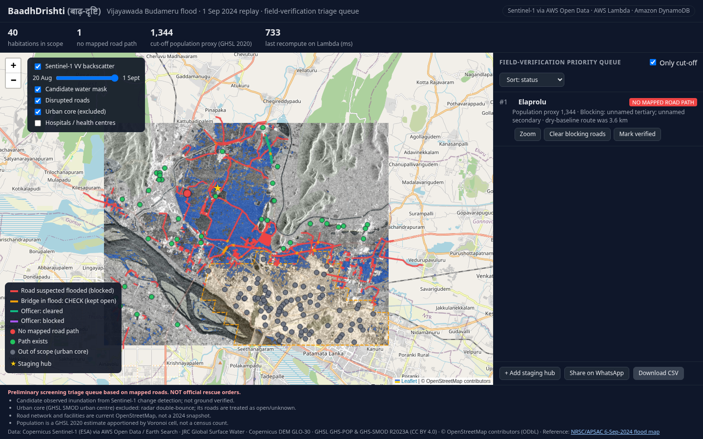

# BaadhDrishti (बाढ़-दृष्टि) — which villages lost every mapped road to a hospital?

**Live demo:** http://baadhdrishti-frontendbucket-e1tfhveh47sy.s3-website.ap-south-1.amazonaws.com · **API:** https://f3m0jdk4wi.execute-api.ap-south-1.amazonaws.com/api/triage
Bharat Builds Tour — Environmental Hacks, Track 02 Heat & Water. Hackathon rules: [`docs/HACKATHON.md`](docs/HACKATHON.md).



After a flood, satellites tell a control room **where the water is**. They do not tell it **which habitations have no
mapped road left to a hospital or relief hub** — the question that decides where field teams verify first.
BaadhDrishti replays the 31 Aug – 2 Sep 2024 Budameru / Krishna flood around Vijayawada: Sentinel-1 radar change
detection → candidate flood mask → OpenStreetMap road graph → ranked **field-verification triage queue**. An officer can
mark a road cleared/blocked or add a staging hub, and the queue is recomputed on AWS Lambda.

It is **not** a rescue-dispatch system, navigation, a forecast, or an official damage assessment.

## What the replay finds (script output, not ground truth)
- 7 peri-urban habitations with **no mapped road path** to any hospital/health centre — Tadepalle, Paidurupadu,
  Elaprolu, Vemavaram, Jakkampudi, Kotturu, Shabada — population proxy 9,314 (GHSL 2020 estimate).
- Clearing the 4 reported blocking segments of Tadepalle's route (Vijayawada–Vissannapeta Road) restores 5 of them.
- Candidate flood area 44.93 km² (432 polygons, 20 m grid) before excluding the 70.4 km² urban core from the road analysis.

## Architecture


| Layer | AWS | What it does |
|---|---|---|
| Data | AWS Open Data (`s3://sentinel-s1-l1c`, Earth Search STAC) | Sentinel-1A GRD, 20 Aug & 1 Sep 2024, relative orbit 92 descending |
| Offline pipeline | — (Python, run once) | σ⁰ calibration + noise removal, geocoding, ΔVV < −3 dB change detection, masks, OSM graph, triage |
| Storage | Amazon S3 | precomputed graph/triage bundle; static frontend |
| API | Amazon API Gateway (HTTP) + AWS Lambda (Python, NetworkX) | multi-source Dijkstra reachability per request |
| State | Amazon DynamoDB | officer road overrides, staging hubs |
| Frontend | Amazon S3 static website | single `index.html` + Leaflet |
| Deploy | AWS SAM | `template.yaml` |

## Method (short)
1. Same-geometry Sentinel-1 pair (S1A, orbit 92, descending) from AWS Open Data; only the AOI window is read.
2. Radiometric calibration with the product LUTs (σ⁰), thermal-noise removal, GCP geocoding to 20 m UTM, and a 250 m
   near-range geolocation correction estimated against JRC permanent water (GCP heights ≠ terrain).
3. 5×5 median, ΔVV < −3 dB **and** post-event VV darker than reference open water; slope > 5° (Copernicus DEM) and
   permanent water (JRC) excluded. Visually checked against the NRSC/APSAC 6-Sep-2024 flood map.
4. OSM drivable roads → graph; a road within 25 m of candidate water is suspected blocked; bridges are never
   auto-disrupted (flagged CHECK). Habitations = OSM villages/hamlets/suburbs/neighbourhoods; destinations = OSM
   hospitals/health centres + officer hubs; population = GHSL GHS-POP 2020 per Voronoi cell.
5. Status order INUNDATED > NO_MAPPED_ROAD_PATH > PATH_EXISTS, then population.

## Honest limits
- Candidate observed inundation, not ground verified; dense urban core excluded (radar double-bounce), as in the NRSC map.
- Road network and facilities are current OpenStreetMap, not a 2024 snapshot.
- Population is a GHSL 2020 estimate, not a census count. No auth on the demo API (throttled).

## Run it
```bash
uv venv --python 3.12 .venv && uv pip install --python .venv/bin/python -r scripts/requirements-offline.txt
# offline pipeline: see PLAN.md §6 (fetch → flood mask → road graph → reachability → bundle → overlays)
.venv/bin/python tests/test_reachability_engine.py && .venv/bin/python tests/test_lambda_local.py
AWS_PROFILE=<your-profile> sam build && sam deploy        # samconfig.toml: stack baadhdrishti, ap-south-1
aws s3 cp data/processed/lambda_bundle.json s3://<DataBucketName>/lambda_bundle.json
scripts/deploy_frontend.sh
```

## Data & credits
Copernicus Sentinel-1 data (ESA) via AWS Open Data / Element 84 Earth Search · JRC Global Surface Water ·
Copernicus DEM GLO-30 · GHSL GHS-POP and GHS-SMOD R2023A (European Commission JRC, CC BY 4.0) ·
© OpenStreetMap contributors (ODbL) · Validation reference: NRSC/APSAC flood map of 6 Sep 2024.
