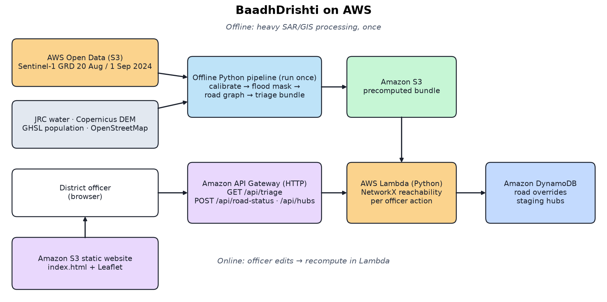

# Which villages lost every road to a hospital? Building BaadhDrishti on AWS

*Bharat Builds Tour — Environmental Hacks · Track 02 Heat & Water · live demo: http://baadhdrishti-frontendbucket-e1tfhveh47sy.s3-website.ap-south-1.amazonaws.com · code: https://github.com/ancientdev0x/aws-env · demo video: https://youtu.be/5Q1qWojO7iI*

## The problem
When the Budameru rivulet flooded Vijayawada in early September 2024, rapid flood maps (NRSC/APSAC, Copernicus) showed
where the water was. What a district control room also needs is a short list: which habitations have **no mapped road
left** to a hospital or relief hub, ranked so field teams know where to verify first. BaadhDrishti replays that event and
produces exactly that — a field-verification triage queue an officer can correct.

## What it does
- Sentinel-1 radar (pre 20 Aug, post 1 Sep 2024) → candidate flood mask.
- OpenStreetMap roads → graph; segments next to candidate water are suspected blocked (bridges only flagged).
- For every habitation: is any mapped road path left to a hospital/health centre or officer hub? Ranked by status, then
  GHSL population estimate.
- The officer marks a road cleared/blocked or adds a staging hub; AWS Lambda recomputes the queue; share via WhatsApp/CSV.

In the replay, 7 peri-urban habitations had no mapped road path (population proxy 9,314); clearing four reported segments
of one route restored five of them.

## The stack
- **AWS Open Data**: Sentinel-1 GRD from `s3://sentinel-s1-l1c`, found via the Earth Search STAC API — read as AOI windows only.
- **Offline Python** (run once): rasterio, NumPy/SciPy, OSMnx, Shapely → a 3.6 MB bundle in **Amazon S3**.
- **Amazon API Gateway + AWS Lambda** (Python, NetworkX): multi-source Dijkstra from all destinations per request
  (measured 560–850 ms of compute per recompute at 1769 MB); responses are gzip-compressed.
- **Amazon DynamoDB**: officer road overrides and staging hubs.
- **Amazon S3 static website**: one `index.html` with Leaflet. **AWS SAM** deploys all of it.

## What fought back
1. **Raw radar is not decibels.** The Earth Search GRD TIFFs are uint16 digital numbers. We applied the product's
   calibration and thermal-noise LUTs to get σ⁰ before any thresholding.
2. **A 250 m geolocation error.** GRD comes with ground-control points whose heights don't match the terrain, so the
   geocoded image sat about 250 m toward far range. We estimated the shift against JRC permanent water (IoU 0.418 → 0.535)
   and checked it independently against OSM water polygons (residual ≤ 20 m) — essential when roads are buffered by 25 m.
3. **Crop fields look like floods.** ΔVV < −3 dB alone flagged farmland south of the Krishna that the NRSC map shows dry.
   Requiring the post-event pixel to be as dark as reference open water (threshold derived from JRC water, −14.01 dB)
   removed most of it.
4. **One bridge hid every cut-off.** OSMnx graph simplification merged short bridge segments into multi-kilometre road
   edges; since bridges are never auto-closed, whole flooded roads stayed open. Splitting edges where the bridge tag
   changes took the result from 1 to 7 cut-off habitations.
5. **Small things:** Overpass hung from Python over IPv4 on our network (curl over IPv6 worked); OSM has few mapped rural
   public buildings, so the demo hub is an officer-nominated village-centre point checked dry in our mask, not a "school".

Recording the demo video against the live site found three more problems, all fixed and redeployed:

6. **Road clicks went nowhere.** Leaflet gave each map pane its own canvas, and the habitation-marker canvas sat on top
   of the roads canvas and swallowed every click, so "mark cleared / blocked" on the map never opened (the queue buttons
   worked, which is why our first smoke test missed it). One shared canvas renderer fixed it; the browser test now clicks
   a road on the map.
7. **Slow field networks.** Each triage response was ~395 kB of JSON. Our own connection measured 56–160 kB/s that day,
   so a single response took 1.3–5.8 s to arrive although Lambda finished in under a second. Gzip brings it to ~64 kB.
8. **Four round trips for one decision.** "Clear blocking roads" sent one request per road segment (about 8 s for four).
   The API now accepts a list of `edge_ids` and recomputes once; the same action takes under 2 s.

## Honest limits
Candidate inundation, not ground truth; dense urban core excluded (radar double-bounce), as NRSC also does; OSM is
today's network, not September 2024's; population is a GHSL 2020 estimate. It is a screening queue, not rescue orders.

## How the demo video was made
Everything in the video is generated from code: the hook, architecture and closing scenes are an HTML page rendered
frame by frame, and the demo part is a scripted headless-browser recording of the live site against the live API, so
every number on screen is real output. Actions are cued from the narration's word timestamps. An independent review
pass checked every number against the project's computed results before the final cut.

## AI tools used
- **Claude Code (Claude Opus 5.5)**: planning, SAR/GIS pipeline, API, frontend, video tooling, code review and QC.
- **agycode** (AI coding agent): executed the frontend / hosting / docs implementation plan.
- **ElevenLabs**: text-to-speech narration for the demo video (script written by the team).

## Try it
Live: http://baadhdrishti-frontendbucket-e1tfhveh47sy.s3-website.ap-south-1.amazonaws.com · Code and reproduce steps: https://github.com/ancientdev0x/aws-env
